<!-- Header banner -->
<div align="center">
  

  <a href="https://github.com/adityacosmos24">
    
  </a>

  <br/><br/>

  <a href="https://www.linkedin.com/in/aditya-agrawal-6b309a282/"></a>
  <a href="mailto:adityacosmos24@gmail.com"></a>
  <a href="https://leetcode.com/u/Space11/"></a>
  <a href="https://codeforces.com/profile/space"></a>
  <a href="https://www.codechef.com/users/adityacosmos37"></a>
  
</div>

<br/>

## whoami

```bash
$ cat about.yml
name:      Aditya Agrawal
handle:    adityacosmos24
location:  Bengaluru, India
role:      SDE Intern, Brick & Bolt
school:    IIIT Bhagalpur, B.Tech CSE '27
focus:     [backend, event-driven systems, concurrency, databases]
currently: LLM powered transcript pipelines, lead assignment under row-level locks
off_duty:  Codeforces rounds, mentoring, open source maintenance
```

I like backend problems where correctness under load is the whole point: ordering guarantees in Kafka, race conditions in concurrent writes, retries that do not melt downstream services. Outside of work I run a coding club and spend too much time on contest ladders.

<br/>

## Pac-Man vs my contribution graph

<div align="center">
  <picture>
    <source media="(prefers-color-scheme: dark)" srcset="https://raw.githubusercontent.com/adityacosmos24/adityacosmos24/output/pacman-contribution-graph-dark.svg" />
    <source media="(prefers-color-scheme: light)" srcset="https://raw.githubusercontent.com/adityacosmos24/adityacosmos24/output/pacman-contribution-graph.svg" />
    
  </picture>
</div>

<br/>

## Experience

| Where | Role | When | What I worked on |
|:--|:--|:--|:--|
| **Brick & Bolt** | SDE Intern | Aug 2026 to present | LLM driven pipeline that parses Google Meet transcripts and quotation data into structured output, feeding floor plan generation and interactive 3D walkthroughs. Lead assignment service in Spring Boot with round-robin and random-match modes, PostgreSQL transactions and row-level locking, split by Residential and Commercial architects. |
| **Aditya Birla Fashion and Retail (TMRW)** | SDE Intern | May 2026 to Aug 2026 | Kafka inventory pipeline publishing 10K+ daily updates with tenant based partitioning and per-tenant ordering. Multi-tenant admin API (Nucleus): 5 controllers, 20+ endpoints, batched concurrency with generators, `Promise.allSettled` and exponential backoff. API failures down 85%. |
| **Ask Senior** | Full Stack Intern | Dec 2025 to Feb 2026 | JWT refresh token auth and authorization middleware in Node and Express. Moved 25+ endpoints from raw SQL to Prisma: faster development by 20%, injection exposure down 30%. |

<br/>

## Stack

<div align="center">

<br/>


</div>

```text
languages    Go, Java, Python, C/C++, JavaScript, TypeScript, SQL
backend      NestJS, Spring Boot, Express.js, tRPC, REST APIs
data         PostgreSQL, MongoDB, MariaDB, Redis, Prisma, TypeORM, Mongoose
infra        Kafka, Docker, Inngest
frontend     React, Next.js, React Flow
fundamentals DSA, OS, OOP, DBMS, Computer Networks (HTTP/HTTPS, TCP/IP)
```

<br/>

## GitHub stats

<div align="center">
  
  
</div>

<div align="center">
  
</div>

<div align="center">
  
</div>

<div align="center">
  
</div>

<br/>
